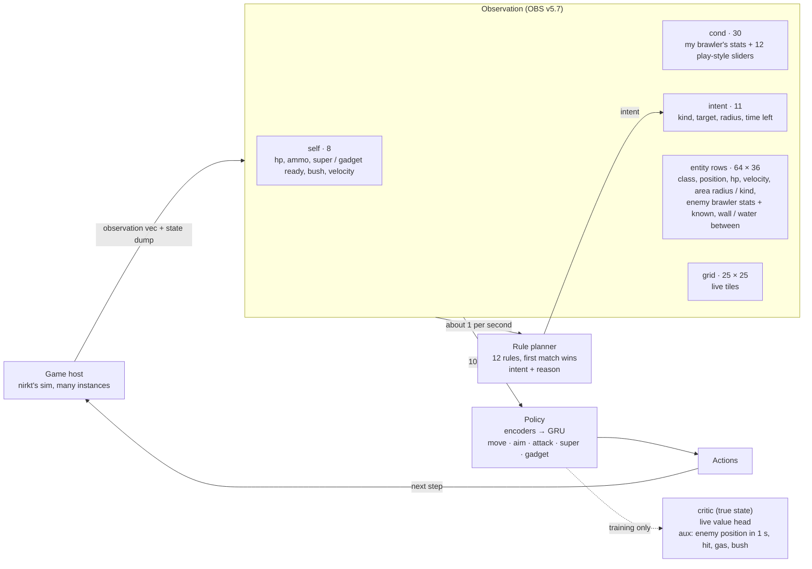
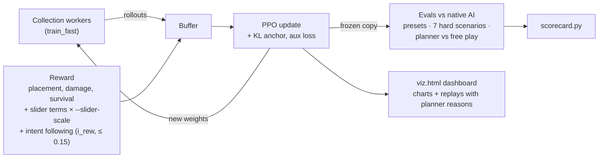
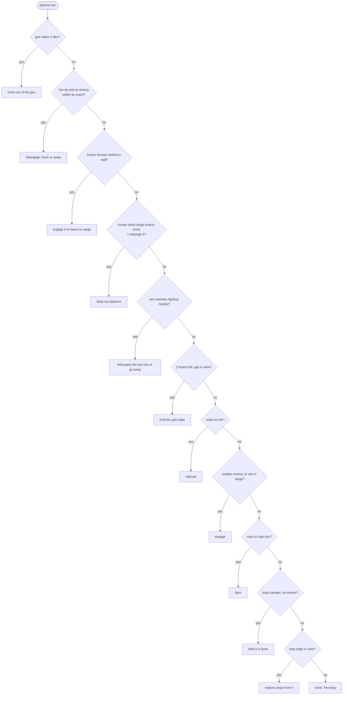
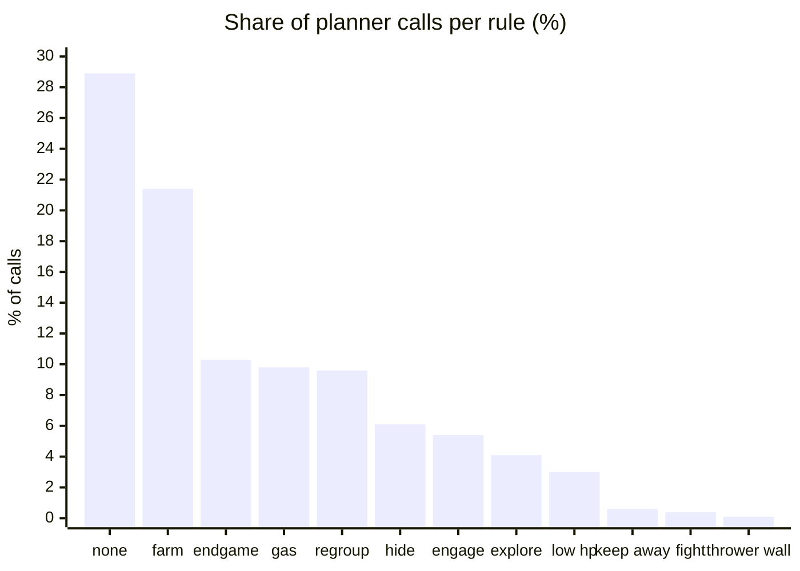

# bsrl-sim

Reinforcement-learning environment and trainer for a 10-player top-down battle royale (Showdown mode). The policy
does not get the true game state. It gets what vision models would read from the screen: a 25 x 25 tile grid of terrain
classes, a set of detected entities with measured detector noise and latency, and a few HUD numbers. That makes this a
testbed for training agents that have to act from imperfect perception, and policies trained here can run behind real
vision models without retraining.

The battles run in **nirkt's** battle host and environment, included under `engine/` (see Credits). `setup.sh` builds
everything. Game files are not included: you supply them.

## How it works

### One decision

The policy acts 10 times a second. About once a second the rule planner reads the same observation and picks an
intent (or none = free play), with a readable reason. The intent goes into the observation's intent block.



### Training loop



Each training battle splits its agents: some follow planner intents (`--p-plan`), some random valid intents
(`--p-rand-intent`), the rest play free. Evals and hard scenarios always play with intent none, so their results stay
comparable across runs.

### Planner rules, in priority order



Thresholds come from the sliders. Rules 3 and 4 need the enemy's brawler and skip enemies that were not identified.
Example reasons: `Undertaker (melee, range 3) 4 tiles E: keeping my distance W`,
`hp 30 %, Gunslinger 9 tiles N (reach 11 tiles): disengaging S`. A higher rule can replace a held intent early.

How often each rule fires (31,053 planner calls, 5-minute live check, noisy observations, 0.65 ms per call):



### Entity row (36 columns)

| Columns | Content | Since |
|---|---|---|
| 0-19 | present, class, dx / dy, hp, velocity, area radius / harms / helps / slows me | v5.3 |
| 20-32 | the row's brawler stats (range, speed, reload, projectile speed, spread, bullets, thrown, melee, hp, super type, super range); a projectile carries its owner's | v5.6 |
| 33 | brawler known (unknown = 13 zeros + 0) | v5.6 |
| 34-35 | wall between us, water between us (on the noisy grid) | v5.6 |

### Observation versions

| Version | Change | Old checkpoints |
|---|---|---|
| v5.3 | live map tiles, area-effect radius and kind, cubes held | zero-padded, act the same |
| v5.4 | sliders: aggressive replaces push; leash and gas_safe added (cond 28 → 30) | zero-padded, act the same |
| v5.5 | intent block (11) at the tail of self | zero-padded, act the same |
| v5.6 | enemy brawler identity and line of sight (entity rows 20 → 36) | zero-padded, act the same |
| v5.7 | fire head: 4th class gadget (zero-initialised `fire_x` head), allowed only while self 3 (gadget ready) is set | `fire_x` zeros, act the same while self 3 is 0 |

## What is here

| File | What it does |
|---|---|
| `env_v5.py` | Randomised Showdown battles on top of nirkt's `MAEnv`: random map, brawlers, solo / duo / trio teams, policy-controlled slots vs the native AI, team placement reward, behaviour-slider reward terms (per-slider normalisation from native-AI battles: `--native 1 --episodes F`, then `--norm F`), gadget loadouts (`with_gadgets`, trainer `--gadgets 1`, default off) and gadget readiness from the host (`Env.gadget` = self 3). `python -m env_v5 --check` |
| `obs_v5.py` | The observation: `self` (8; self 3 = gadget ready, v5.7), `ent` (39 x 36 entity slots; area effects with radius and harms / helps / slows me; enemy / teammate brawler and projectile-owner identity (brawler stats + known flag, per-battle identity noise); wall / water between me and each player), `grid` (25 x 25 tile classes), `cond` (30: brawler stats, 12 slider weights, team size, cubes, players left), the intent block (11: kind one-hot, target offset, radius, time left; all zeros = free play); named slider presets (play-style modes: bush camper, aggressive, cube farmer, ...). Per-episode detector noise, latency and HUD masking. `python -m obs_v5` |
| `intent.py` | Intents (per-second goals: move to, avoid, hold, engage, farm, regroup, hide): kind specs and end rules, the block encoder, the intent-following reward (signed progress, capped per intent), the random-valid sampler. `env_v5.Env.intents` runs them in battles (trainer `--intent-scale`, default 0 = off). `python -m intent` |
| `planner.py` | Rule planner: 12 priority rules (gas, low HP, thrower behind a wall, keep away from a short-range enemy, fight / third party, endgame, regroup, engage, farm, hide, explore, none) on what the policy sees, thresholds from the sliders, rules needing the enemy's brawler skip unknown ones; each pick has a readable reason (replay frames, viz). Training rollouts: trainer `--p-plan` (default 0 = off; design 0.5) with preemption of held planner intents; `--eval-plan 1` = eval kind `evalp_plan` (planner vs free play, same seeds). `python -m planner` |
| `fast_obs.py`, `fast_act.py` | Batched, vectorised versions of the observation builder and the actor for the multi-process trainer (bit-equal to the reference paths). |
| `model.py` | Policy: entity set + tile grid + conditioning -> GRU -> move (17) / fire (4: none, attack, super, gadget; super / gadget masked until ready) / aim (360, pointer over targets) / distance heads, critic with a privileged branch; heads that never act: a live value without the privileged input (`--vlive`) and aux predictions of the true state (enemy positions in 1 s, being hit, gas, hidden bush enemies; `--aux-w`). `python -m model` |
| `train_ppo.py` | Behaviour cloning from the native AI, then PPO with a KL anchor, league / self-play, evals, replays; live value / aux head targets and readouts. `python -m train_ppo --check` |
| `train_fast.py` | Same trainer with environment collection split over worker processes (shared memory). |
| `scorecard.py` | Skill metrics of a run from its logs: placement, win rate, trade, hit rate, aim lead, cube and gas stats; behaviour per slider preset (pass rules vs balanced) and per-slider effect slopes. `python scorecard.py --check` |
| `super_audit.py` | Per-brawler super audit: fires every brawler's super at a target and records what happened (works / partial / unverified / no effect / not fired / crash); checklist in issue #6. `python -m super_audit [--n 2] [--only A,B]`, `--check` |
| `scenarios.py` | Hard-scenario eval set: 7 seeded situations (gas endgame, third party, assassin rush, low HP with an enemy close, cube-rich enemy at low HP, teammate under fire, bush memory) x 2 maps x 2 brawler picks x 4 layouts, set up by teleports and a forced storm, each with episode scores and a pass rule. Trainer `--eval-scenarios 1` (every `--scenario-every`-th eval) -> `scenarios.jsonl`, replays in `replays/scn/` (viz: failures first). `python -m scenarios --check`, `python -m scenarios --ckpt X --n 2` |
| `gadget_check.py` | One-boot check of gadget activation: the loadout reaches the host, each implemented kind's effect, uses and cooldown spent, fire 3 while not ready spends nothing, `Env.gadget` agrees with the host. `python -m gadget_check`, `--check` |
| `live_check.py` | One-boot check of the host round: team reward, area effects (radius, kind), teammate respawn, HUD mask, live map tiles, cubes lost at a knock-out. |
| `test_fast.py` | Equality and timing of the fast paths against the reference paths on real battles. |
| `apply_noise.py` | Writes a measured detector-noise report into `obs_v5.NOISE` (with sanity limits). |
| `viz.html` | Run dashboard: training / eval curves, action histograms, battle replay with the policy's view. |
| `hud_ui.npy` | Measured share of each tile hidden by the game HUD (used by the noisy observation). |
| `env.sh` | Environment variables for the host, nirkt's packages and the work folder. |
| `setup.sh` | One-command setup: host build, venv, game files (SETUP.md). |
| `engine/` | nirkt's battle host and environment as one tree: `native/` (host sources, qemu patches), `py/` (`nbpc`, `models4.py`), `train/`, nirkt's vision-label tools; this project's changes applied. What came from where: `engine/NOTICE.md`. |
| `engine/patches/` | Record of this project's changes to nirkt's host and camera rules (`training_round`, `fair_view`, `live_state`, `gadgets`; already applied in `engine/`). |
| `pro_strategies.md` | Community Showdown habits and what each means for the observation / reward. |

## Vision models

The detector and segmentation models this observation is built around are in
**[showdown-vision](https://github.com/mlgdoggynoob/showdown-vision)**. Each model version is a release there with its
model files (ONNX and PyTorch), class lists, val numbers and validation set; the README gives the exact
pre / post-processing.

## Requirements

- Linux or WSL2 (developed on Ubuntu 24.04), Python 3.11+, PyTorch (CUDA or ROCm for real runs; CPU is fine for the
  self-checks).
- The game build the host is made for. `setup.sh` downloads it once from nirkt's copy (or takes `APK=/path/to.apk`)
  and checks it against nirkt's checksum.

## Setup

```bash
git clone https://github.com/mlgdoggynoob/bsrl-sim && cd bsrl-sim
./setup.sh                  # or APK=/path/to/nb_68.279_release_7c5c5152.apk ./setup.sh
source env.sh
```

What `setup.sh` does, the pinned versions and troubleshooting: **[SETUP.md](SETUP.md)**.

Self-checks (no battle is booted; `obs_v5` / `env_v5` read the game's data tables, so they need the game files):

```bash
python -m obs_v5 && python -m intent && python -m planner && python -m model && python -m fast_obs && python -m env_v5 --check && python -m train_ppo --check && python -m scenarios --check && python -m gadget_check --check && python apply_noise.py --test
```

Live checks (boot the host; each boot takes about 60-90 s):

```bash
python -m live_check --n 2 --minutes 8
python -m gadget_check                              # which gadget kinds the built host activates
python -m env_v5 --n 4 --minutes 2 --agents 10      # random-action benchmark
```

Training:

```bash
python -m train_ppo --run t --smoke                 # plumbing check: 2 instances, 3 updates
python -m train_fast --run my_run --hours 6 [flags]  # outputs $SIM_WORK/runs/my_run/
python scorecard.py my_run
cd $SIM_WORK/runs && python -m http.server 8766      # dashboard: http://localhost:8766/my_run/
```

`python -m train_ppo --help` lists every flag (sliders, teams, league, KL anchor, reward weights).

## Notes

- Comments cite numbered entries of the project's private decision log (`HISTORY N`). They explain why a value is
  what it is; the log itself is not published.
- Generated layouts (`--gen`) were made for the vision models' training data and are not used for RL; their
  generator is not in this repository.
- The fire head is none / attack / super / gadget. The gadget class is masked unless the host activates that gadget's
  kind (`gadget.c`, none implemented yet) and a use is left (`obs_v5` self 3). Hypercharge cannot be triggered yet.
  Training with gadget loadouts is `--gadgets 1` (off by default).
- Observation layout changes must be mirrored by anything that consumes exported policies. `obs_v5` carries the
  version (`obs_v5.OBS_VERSION`, now `v5.7`; saved in every checkpoint) that exported policies are checked against.

## Licence

GNU Affero General Public License v3.0, see [LICENSE](LICENSE), for this project's own code. `engine/` is not covered by
it (see Credits).

## Credits

Built on [nirkt](https://github.com/nirkt)'s work: the battle host
([bulletlabels](https://github.com/nirkt/bulletlabels) @ `52184b2`) and the environment
([nbrl-env](https://github.com/nirkt/nbrl-env) @ `7ff57bc`) in `engine/` are nirkt's code, redistributed here with
nirkt's permission and under nirkt's terms (not this project's licence), with this project's changes from `engine/patches/`
applied.
